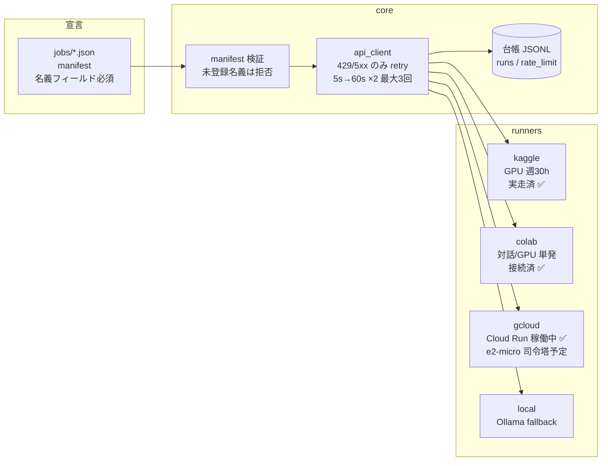

# cloud-autopilot

無料枠のクラウド (Colab / Kaggle / Google Cloud) とローカルを使い分けて、AI 自走ジョブを
「どの環境で・どの名義で・本当に走ったか」まで追える形で回すための runner 基盤。

## ゴール

**「利用者が寝ていても、AI が無料枠で仕事を進め、朝には証跡付きの結果だけが残っている」状態。**

具体的には:

1. ジョブを manifest (1 ファイル) で宣言すると、適切な実行環境で走り、結果と証跡が台帳に残る
2. レート制限 (429) やクォータ切れで**黙って止まらない** — 記録され、待つか別環境に回る
3. 名義 (Google 3 アカウント / Kaggle / GitHub 2 名義) を取り違えない — 構造で防ぐ

### 非ゴール

- 有料 GPU・課金前提の最適化 (無料枠が主戦場)
- 実行内容そのものの品質保証 (それは各プロジェクトの仕事)
- 公開サービスの運営 (これは内部インフラ)

## ロードマップ

| Phase | 内容 | 状態 |
|---|---|---|
| **0. 接続実測** | 全環境の接続・名義・無料枠を実測しマップ化 | ✅ 完了 (2026-08-25) — `docs/connection-map.md`（公開版には未同梱） |
| **1. 最小 runner** | core (manifest / 429台帳 / バックオフ) + kaggle runner で GPU ジョブを 1 本実走 | ✅ 完了 (2026-08-25) — テスト 10 件緑 + GPU smoke 実走 |
| **2. 自走ループ** | ジョブキュー / 自動再開 / local fallback / colab runner (公式 CLI 経路) | ✅ 実装済 (2026-08-25) — E2E 実測。Colab CLI 本体のセットアップのみ人間のブラウザ承認待ち |
| **3. 司令塔常駐** | GCP e2-micro (恒久無料) に台帳とスケジューラを常駐、GitHub Actions 定期起動と接続 | 未着手 |
| **4. 横展開** | 既存プロジェクト (シミュレーター・note パイプライン等) のジョブをここに乗せる | 未着手 |

## 全体像



## 使い方

```bash
# キューのジョブを順に実行 (完了済みはスキップ = 自動再開)
python autopilot.py queue

# 単発実行 / 状態確認
python autopilot.py run jobs/kaggle-gpu-smoke/job.json
python autopilot.py status

# テスト
python -m pytest tests/ -q
```

- ジョブは `jobs/queue/*.json` に manifest を置くだけ。失敗した runner は manifest の `"fallback": ["local"]` に回る (名義事故防止のため fallback は local のみ)
- 台帳は `data/runs.jsonl` (実行) と `data/rate_limit.jsonl` (429 等) に追記される

### Colab runner の前提 (一次情報 2026-08-25 確認)

Colab CLI (`google-colab-cli`, 2026-06 公式リリース) は **Windows 非対応**のため WSL 経由で叩く。
初回セットアップは人間作業: WSL 内で `uv tool install google-colab-cli` → `colab auth` (ブラウザ承認)。
Colab MCP サーバー (2026-03, [googlecolab/colab-mcp](https://github.com/googlecolab/colab-mcp)) は AI エージェント対話用で、スクリプト自走には CLI が適する。

## 脅威モデル (threat-model-first)

- **誰から**: (a) 自走ジョブの空振り (成功ログ付きで何もしていない)、(b) 名義取り違え (Colab=サンプル名義A / gcloud=サンプル名義B が混在)、(c) 429・クォータ枯渇による黙った停止。
- **何を守る**: 実行の帰属 (どの名義で何が走ったか) と結果の実在性 (本当に走った証跡)。
- **どうなると困る**: 空振りを「完走」と誤認して積み上げる / 意図しない名義で課金・書込みが起きる / 止まったのに誰も気づかない。
- **守らないもの**: アカウント乗っ取り対策 (各サービスの認証に委ねる)、有料枠のコスト最適化、実行内容の品質。

## 停止線

- 外部公開・visibility 変更・公開 URL が生えるデプロイは人間レビュー後
- 課金が発生しうる操作 (有料 GPU・予算超過) は都度承認
- Kaggle アカウントは 1 つ (`YOUR_KAGGLE_ACCOUNT`) のみ — 規約上、複数アカウントは作らない
- 初期構築後の main への push は PR 経由

## 運用正本

- 接続実測・名義マップ・無料枠 (2026-08 再確認): `docs/connection-map.md`（公開版には未同梱）
- 各 runner の制約と経路: `runners/*/README.md`
